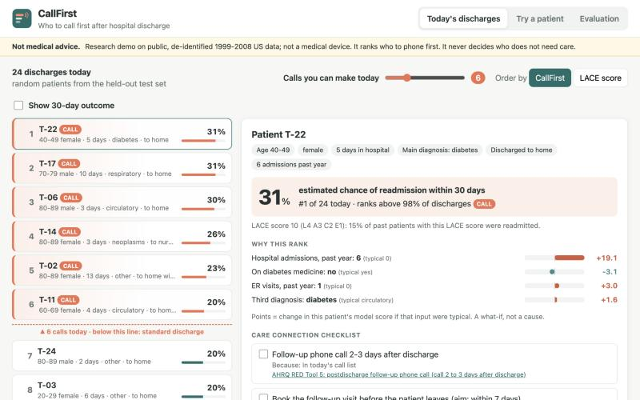
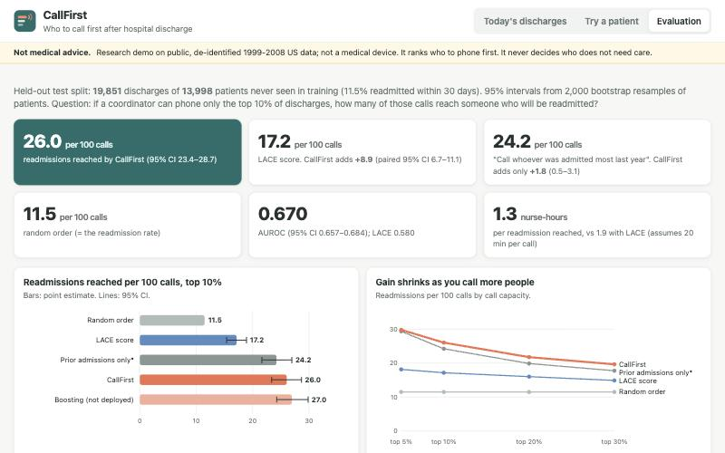

<p align="center"></p>

# CallFirst: who to call first after hospital discharge

A care coordinator can phone only some of today's discharges. CallFirst ranks them by estimated
risk of readmission within 30 days, shows **why** each patient ranks where they do, and turns the
patient's own data into a short **care-connection checklist** (follow-up call, visit booking,
medication check, diabetes follow-up, home support) with the public guidance behind each item.

> **Not medical advice.** Research demo trained and tested on public, de-identified US data from
> 1999-2008. It is not a medical device. It ranks who to phone first; it never decides who does not
> need care.



## Result in one table

Held-out test split: 19,851 discharges of 13,998 patients the model never saw. The coordinator can
call the top 10% (1,985 calls). 95% CIs from 2,000 bootstrap resamples of patients.

| Ranking | Readmissions reached per 100 calls | Share of all readmissions reached |
|---|---:|---:|
| Random order | 11.5 | 10.0% |
| LACE index (published bedside score) | 17.2 (15.4–18.9) | 14.9% |
| Prior admissions only (simple rule, added post-hoc) | 24.2 (21.6–27.0) | 21.1% |
| **CallFirst** (logistic regression) | **26.0 (23.4–28.7)** | **22.6%** |

- CallFirst vs LACE: **+8.9** readmissions per 100 calls (paired 95% CI 6.7–11.1).
- CallFirst vs the one-variable rule "call whoever had the most admissions last year": **+1.8**
  (0.5–3.1). Most of the gain over LACE comes from that one input. We say so up front.
- AUROC 0.670 (0.657–0.684); LACE 0.580. Calibrated: mean predicted 11.8%, observed 11.5%.
- Weakest group: patients aged 80+ (AUROC 0.595).



Full tables: [reports/EVALUATION.md](reports/EVALUATION.md). Protocol, written before the test split
was scored: [docs/PROTOCOL.md](docs/PROTOCOL.md).

## Run it

Needs Python 3.9 or newer, about 350 MB of disk for the libraries, no GPU, no API keys.
`requirements.txt` takes any recent versions; `requirements-lock.txt` pins the exact ones behind the
published numbers (needs Python 3.12+).

```bash
git clone <this repository> callfirst && cd callfirst
python3 -m venv .venv
source .venv/bin/activate            # Windows: .venv\Scripts\activate
pip install -r requirements.txt

python scripts/download_data.py      # ~3 MB zip from UCI, checks SHA-256
python -m callfirst.train            # trains, evaluates, writes reports/ (about 1.5 minutes)
python -m callfirst.app              # open http://127.0.0.1:8000
```

`python -m callfirst.train --quick` uses 200 bootstrap resamples instead of 2,000 for a fast check.
`pytest` runs the tests (LACE scoring, tie handling, patient-level bootstrap, checklist rules, API).
Change the port with `CALLFIRST_PORT=8080 python -m callfirst.app`.

On macOS with numpy 2.0.x (what Python 3.9 installs), training may print several
`RuntimeWarning: ... encountered in matmul` lines from scikit-learn. They are harmless: a fresh
clone on Python 3.9 with those warnings produced the same results as the published run (see
[Reproducing the evaluation](#reproducing-the-evaluation)).

### What you will see

1. **Today's discharges**: 24 random patients from the held-out test split, ordered by CallFirst.
   Drag **Calls you can make today**; the top rows get a CALL tag. Click a patient for the risk
   estimate, the LACE comparison, the inputs that moved the score, and the checklist. Switch the
   order to **LACE score** to compare. Tick **Show 30-day outcome** to see who was actually
   readmitted (24 patients is an anecdote; the Evaluation tab has the real test).
2. **Try a patient**: change a made-up patient's details and watch the score, the reasons and the
   checklist update.
3. **Evaluation**: the held-out results above, with confidence intervals, calibration, and errors by
   age, sex and race.

## Reproducing the evaluation

Everything that affects the numbers is in [`callfirst/config.py`](callfirst/config.py): seed
`20261204`, patient-level 60/20/20 split, model grids, capacities, bootstrap count, minutes per call.
The data file is checked against a SHA-256 hash. `reports/metrics.json` records the versions used.

| Run | Environment | AUROC | Per 100 calls at 10% (95% CI) | vs LACE | vs prior admissions |
|---|---|---:|---:|---:|---:|
| Published (3 identical runs) | Python 3.12.16, scikit-learn 1.9.1, numpy 2.5.5, pandas 3.1.1 | 0.6703 | 26.05 (23.37–28.66) | +8.88 | +1.82 |
| Fresh install from `requirements.txt` | Python 3.9.6, scikit-learn 1.6.1, numpy 2.0.2, pandas 2.3.3 | 0.6703 | 26.05 (23.37–28.66) | +8.88 | +1.82 |

Across these two environments the largest difference in any reported metric (selection, test,
paired differences, calibration, subgroups) is 1.3e-14, i.e. floating-point noise. If your numbers differ, compare the
`environment` and `data.sha256` fields of `reports/metrics.json` first.

## Method

**Task.** Rank discharges by probability of readmission within 30 days (UCI label `readmitted == "<30"`).

**Data.** UCI *Diabetes 130-US Hospitals for Years 1999-2008*: 101,766 inpatient encounters of
adults with diabetes in 130 US hospitals. Removed: 2,423 encounters ending in death or hospice (no
follow-up call possible, as in Strack et al. 2014) and 3 with unknown sex; 99,340 remain.

**Inputs (25).** Age band, sex, admission type and source, discharge destination, length of stay,
counts of lab tests, procedures, medications and diagnoses, prior-year outpatient, ER and inpatient
visits, admitting specialty, three diagnosis groups (ICD-9 chapters), HbA1c and glucose results,
insulin and metformin status, number of diabetes medicines and dose changes. **Race is not an
input**; it is used only to audit errors. Insurance (`payer_code`) and weight are not used.

**Split.** By patient (`patient_nbr`), 60/20/20, so no patient is in two splits.

**Models.** Logistic regression (log-scaled counts, one-hot categories, L2) and histogram gradient
boosting, each tuned on the validation split. A rule fixed before testing: deploy logistic regression
unless boosting wins by at least 0.01 validation AUROC. Boosting won by 0.0001, so the simpler,
easier-to-audit model is deployed. Probabilities are calibrated with isotonic regression on the
validation split.

**Baselines.** Random order; the LACE index (van Walraven et al., CMAJ 2010) computed from this
dataset (approximation: Charlson index from the 3 recorded diagnoses, prior-year rather than
6-month ER visits); and, added after the first test run, "prior admissions only".

**Why this rank.** For each input we swap in the typical training value and re-score; the change in
score is shown as points. It is a local what-if, not a causal claim.

**Checklist.** Fixed rules, not the model, pick actions from the patient's data: e.g. a prior
admission or ER visit leads to "book the follow-up visit before discharge", an insulin dose change
leads to "medication reconciliation". Each item shows what triggered it and its source (AHRQ RED
toolkit, CMS Transitional Care Management, ADA Standards of Care). A fixed safety note says red-flag
symptoms mean emergency care whatever the score.

## Evaluation

- **Primary metric:** readmissions reached per 100 calls when calling the top 10% of discharges
  (positive predictive value at fixed capacity), compared with LACE, the prior-admissions rule, and
  random order.
- **Also:** share of readmissions reached at 5/10/20/30% capacity, nurse time per readmission
  reached (assumes 20 minutes per call, the low end of the 20-60 minutes AHRQ RED Tool 5 gives),
  AUROC, AUPRC, Brier score, calibration by decile, subgroup results.
- **Uncertainty:** 2,000 bootstrap resamples of patients (a patient's encounters move together);
  model-vs-baseline differences are paired.
- **Ties** in LACE at the cut-off count at their average outcome, so results do not depend on row order.

## Who benefits, and who could be harmed

- **Benefits:** care coordinators and discharge nurses with more patients than call slots; patients
  at high risk who would otherwise wait in an unordered list. At 10% capacity the model reaches
  about 9 more readmitted patients per 100 calls than LACE.
- **Could be harmed:** patients ranked low who still get readmitted. At 10% capacity, 77% of
  readmissions are *not* in the call list, so the list must never replace standard discharge
  teaching or a clinician's judgement. Patients aged 80+ are ranked least accurately (AUROC 0.595):
  they get slightly more calls than average, but a smaller share of their readmissions is reached
  (19.8% vs 22.6%). Groups with few readmissions in the data (Asian, Hispanic, Other) cannot be
  evaluated reliably. Because prior admissions dominate, patients with poor access to care (few
  recorded visits) may be under-ranked.

## Limitations

- Old, US-only, diabetic-inpatient data (1999-2008). No claim for current practice, other
  populations or other countries, including Korea, without local re-validation and recalibration.
- It predicts who is likely to be readmitted, not who a call would help. We did not measure whether
  calls prevent readmissions.
- The model adds little over a one-variable rule (+1.8 per 100 calls).
- LACE is approximated from limited fields, so the LACE comparison likely flatters CallFirst.
- Readmissions to other hospitals are not in the data.
- 20 minutes per call is an assumption, not a measurement.

## With another month

1. Validate on a second, more recent dataset (for example MIMIC-IV after credentialing) and report
   how much performance drops.
2. Estimate who **benefits** from a call (uplift), not just who is at risk, using published
   transitional-care trial results.
3. Run the checklist past discharge nurses and measure time per call and acceptance of each item.
4. Korean pilot design: map the checklist to the 2026 Integrated Community Care services and
   recalibrate on Korean data.

## Attribution

- **Data:** Clore J, Cios K, DeShazo J, Strack B. *Diabetes 130-US Hospitals for Years 1999-2008*
  [Dataset]. UCI Machine Learning Repository, 2014. https://doi.org/10.24432/C5230J. CC BY 4.0.
  Not redistributed here; `scripts/download_data.py` fetches it.
- Strack B, et al. Impact of HbA1c measurement on hospital readmission rates. *BioMed Research
  International* 2014:781670 (exclusions and ICD-9 groups).
- van Walraven C, et al. Derivation and validation of an index to predict early death or unplanned
  readmission after discharge from hospital to the community. *CMAJ* 2010;182(6):551-557 (LACE).
- Charlson comorbidity ICD-9 mapping after Deyo RA, Cherkin DC, Ciol MA. *J Clin Epidemiol* 1992;45(6):613-619.
- Checklist sources: [AHRQ Re-Engineered Discharge (RED) Toolkit](https://www.ahrq.gov/patient-safety/settings/hospital/red/toolkit/index.html),
  [CMS Transitional Care Management](https://www.cms.gov/medicare/payment/fee-schedules/physician-fee-schedule/care-management/transitional-care-management-services),
  [ADA Standards of Care in Diabetes](https://professional.diabetes.org/standards-of-care).
- Libraries: scikit-learn, NumPy, pandas, SciPy, FastAPI, Uvicorn, pytest. No pre-trained models.
- **AI tools:** Built with Claude Code (Anthropic, Claude Opus 5.5). It read the hackathon rules,
  proposed three project options (the author chose this one), designed the evaluation protocol,
  wrote the code, tests, interface, logo and documentation, ran the experiments, and checked the
  cited sources. The author set the direction and made the decisions on scope and publication.

## License

Code: MIT (see [LICENSE](LICENSE)). The dataset keeps its own CC BY 4.0 license.
